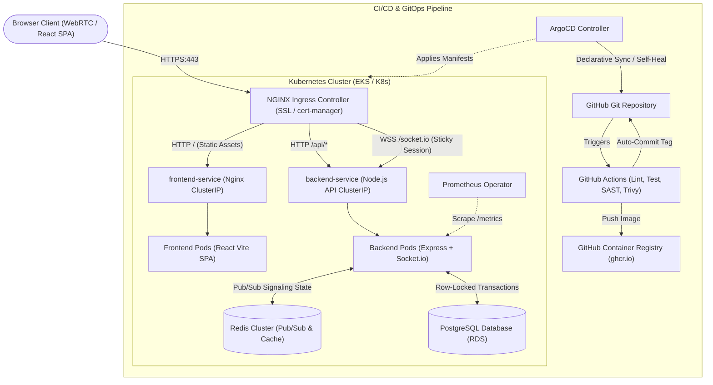

# SkillSwap: Peer Learning & Time-Banking Platform

A cloud-native, production-ready peer-to-peer skill exchange platform built with React, Node.js/TypeScript, PostgreSQL, Redis, Socket.io (WebRTC), Kubernetes, and GitOps (GitHub Actions + ArgoCD).

---

## 🏗️ Architecture Overview



---

## 📁 Repository Directory Structure

```text
.
├── .github/
│   └── workflows/
│       └── ci.yml               # GitHub Actions: Lint, Test, SAST, Trivy, Docker Push, GitOps Commit
├── argocd/
│   └── application.yaml         # ArgoCD Declarative Application CRD (automated sync & self-heal)
├── k8s/
│   └── base/
│       ├── namespace.yaml
│       ├── configmap-secrets.yaml # ConfigMap and Secrets templates
│       ├── backend.yaml          # Backend Deployment & ClusterIP Service
│       ├── frontend.yaml         # Frontend Deployment & ClusterIP Service
│       ├── hpa.yaml              # Horizontal Pod Autoscalers (Backend & Frontend)
│       ├── ingress.yaml          # NGINX Ingress with WebSocket Sticky Sessions & cert-manager TLS
│       └── kustomization.yaml   # Kustomize root manifest
├── terraform/
│   ├── main.tf                  # AWS VPC, Subnets, RDS PostgreSQL, ElastiCache Redis
│   ├── variables.tf
│   ├── outputs.tf
│   └── terraform.tfvars.example
├── docker-compose.yml           # Full local stack: Postgres, Redis, MailHog, API, Web UI
├── backend/
│   ├── Dockerfile               # Multi-stage hardened build with dumb-init and non-root user
│   ├── package.json
│   ├── tsconfig.json
│   ├── prisma/
│   │   └── schema.prisma        # Complete production PostgreSQL schema with relations & indexes
│   └── src/
│       ├── server.ts            # Express server, Prometheus metrics, graceful shutdown
│       ├── config/index.ts      # Structured Pino logger, Prometheus metrics registry
│       ├── signaling/
│       │   └── signaling.gateway.ts # Multi-replica Socket.io WebRTC signaling via Redis
│       └── ledger/
│           ├── ledger.types.ts
│           ├── ledger.service.ts    # Race-condition-safe DB transactional ledger
│           └── ledger.service.test.ts
└── frontend/
    ├── Dockerfile               # Multi-stage build: Vite build -> Alpine Nginx SPA reverse proxy
    ├── nginx.conf               # Hardened headers, gzip compression, SPA fallback routing
    ├── package.json
    ├── tsconfig.json
    ├── vite.config.ts
    ├── index.html
    └── src/
        ├── main.tsx
        └── App.tsx
```

---

## 🚀 Quickstart Commands

### 1. Local Development via Docker Compose
To spin up all services locally (PostgreSQL, Redis, MailHog, Node.js API, and React Frontend):

```bash
# Start all containers in the background
docker-compose up --build -d

# Check health and status of containers
docker-compose ps

# Follow logs from the backend API
docker-compose logs -f backend
```

- **Frontend Application**: [http://localhost:3000](http://localhost:3000)
- **Backend API & Healthcheck**: [http://localhost:5000/healthz](http://localhost:5000/healthz)
- **Prometheus Metrics**: [http://localhost:5000/metrics](http://localhost:5000/metrics)
- **MailHog UI**: [http://localhost:8025](http://localhost:8025)

---

### 2. Running Backend Tests & Database Migrations

```bash
cd backend

# Install dependencies
npm ci

# Generate Prisma Client from schema
npm run prisma:generate

# Execute unit and ledger integration tests
npm test
```

---

### 3. Deploying Cloud Infrastructure (Terraform)

```bash
cd terraform

# Initialize providers
terraform init

# Plan infrastructure creation
cp terraform.tfvars.example terraform.tfvars
terraform plan

# Apply infrastructure changes
terraform apply -auto-approve
```

---

### 4. Deploying to Kubernetes via Kustomize & GitOps

```bash
# Preview generated manifests
kubectl kustomize k8s/base

# Direct apply (Manual)
kubectl apply -k k8s/base

# GitOps Automated Deployment (ArgoCD)
kubectl apply -f argocd/application.yaml
```


# Online-Skill-Exchanger-and-Peer-Learning
 e0e5971f66443f9a54dfdb0841b86064498890d4
